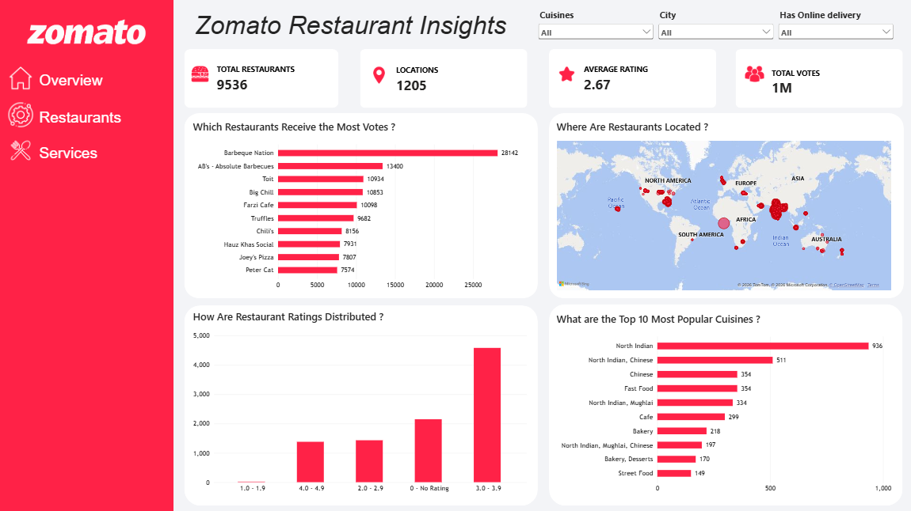

# 🍽️Zomato Restaurant Insights Dashboard | Power BI

## 📌Project Overview

This project analyzes restaurant data from Zomato using Microsoft Power BI to explore restaurant distribution, customer engagement, rating patterns, and cuisine popularity.

The interactive dashboard provides key performance indicators (KPIs), visualizations, and slicers to help users explore restaurant data and identify meaningful insights.

## 🎯Objectives

- Analyze restaurant distribution across cities and locations.
- Understand restaurant rating patterns.
- Identify restaurants with the highest number of customer votes.
- Discover the most popular cuisines.
- Explore the availability of online delivery.
- Build an interactive dashboard for data-driven analysis.

## 🗒️Dataset

- Restaurant ID
- Restaurant Name
- Country Code 
- City
- Address
- Locality
- Locality Verbose
- Longitude
- Latitude
- Cuisines
- Average Cost for two
- Currency
- Has Table booking
- Has Online delivery
- Is delivering now
- Price Range
- Aggregate Rating
- Rating Color 
- Rating Text
- Votes

## 🧹Data Cleaning & Preparation

Data preparation was performed using Power Query in Microsoft Power BI.

## 🔧Cleaning Steps

1. Data Import: Imported the Zomato restaurant dataset into Power BI.
2. Data Inspection: Reviewed column names, data types, missing values, and data consistency.
3. Column Names: Checked column names to ensure they were clear and consistent.
4. Data Types: Verified that columns had appropriate data types, including text, whole numbers, decimal numbers, and geographic coordinates.
5. Missing Values: Inspected missing values and handled them according to the requirements of each column.
6. Duplicate Records: Checked for duplicate records and evaluated them before making any changes.
7. Rating Validation: Reviewed "Aggregate rating" values to identify unrated restaurants and ensure ratings were handled correctly.
8. Cuisine Data: Inspected the "Cuisines" column for missing or inconsistent entries.
9. Geographic Data: Checked "City", "Latitude", and "Longitude" for consistency and suitability for map visualization.
10. Service Fields: Reviewed "Has Online delivery" and "Has Table booking" to ensure consistent categorical values.
11. Final Validation: Verified the cleaned data and confirmed that the required columns were ready for KPI calculations, charts, maps, and slicers.

## ✅Outcome

The dataset was prepared for interactive analysis in Power BI, supporting restaurant rating analysis, customer vote comparisons, cuisine popularity analysis, and geographical visualization.

## 🔎Analysis Questions

This project aims to answer the following questions:

- Which restaurants receive the most votes?
- Where are restaurants located?
- How are restaurant ratings distributed?
- What are the top 10 most popular cuisines?
- Which cities have the largest number of restaurants?
- How does restaurant availability vary when filtering by online delivery?
- How do restaurant ratings and vote counts vary across different cities and cuisines?

## 📊Key Performance Indicators (KPIs)

The dashboard includes four KPIs:

- Total Restaurants: Number of restaurants in the dataset.
- Locations: Number of locations represented in the dataset.
- Average Rating: Average aggregate restaurant rating.
- Total Votes: Total customer votes received by restaurants.

## 📈Dashboard Visualizations

1. Which Restaurants Receive the Most Votes?

A chart highlighting restaurants with the highest number of customer votes to explore customer engagement.

2. Where Are Restaurants Located?

A geographical map showing restaurant locations and their distribution across different areas.

3. How Are Restaurant Ratings Distributed?

A chart showing the distribution of restaurants across rating ranges to understand overall rating patterns.

4. What Are the Top 10 Most Popular Cuisines?

A chart identifying the ten most common cuisines based on the number of restaurants.

## Dashboard Preview

## Interactive Slicers

The dashboard includes three slicers:

- City: Filter restaurants by city.
- Cuisines: Explore specific cuisine categories.
- Has Online Delivery: Filter restaurants by online delivery availability.

These slicers allow users to interact with the dashboard and explore how results change across different selections.

## 🛠️Tools & Technologies

- Microsoft Power BI — Dashboard creation and data visualization.
- Power Query — Data preparation and cleaning.
- Data Analytics — Exploring patterns and answering business questions.

## 💡Expected Insights

The dashboard helps users explore:

- Restaurant locations and distribution patterns.
- Restaurants receiving the highest customer engagement.
- The distribution of restaurant ratings.
- The most common cuisines.
- Differences between restaurants based on city, cuisine, and online delivery availability.

## 🚀Conclusion

This project demonstrates the use of Power BI to transform restaurant data into an interactive dashboard. It combines KPIs, charts, a geographical map, and slicers to support restaurant data exploration and business analysis.

📚 Data Source & License

- Dataset: Zomato Restaurant Dataset
- Source: Kaggle
- License: Creative Commons Attribution-ShareAlike 4.0 International (CC BY-SA 4.0)

The dataset is provided under the CC BY-SA 4.0 license. It may be shared and adapted, provided that appropriate credit is given, a link to the license is included, and any adaptations are distributed under the same license.

License Link: "CC BY-SA 4.0" (https://creativecommons.org/licenses/by-sa/4.0/)

Dataset Link: "View Dataset on Kaggle" (https://www.kaggle.com/datasets/srisyra02/zomato-market-analysis)

## Author

anis-mo
